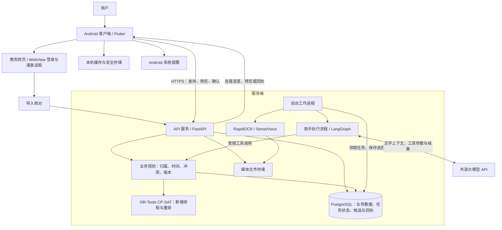
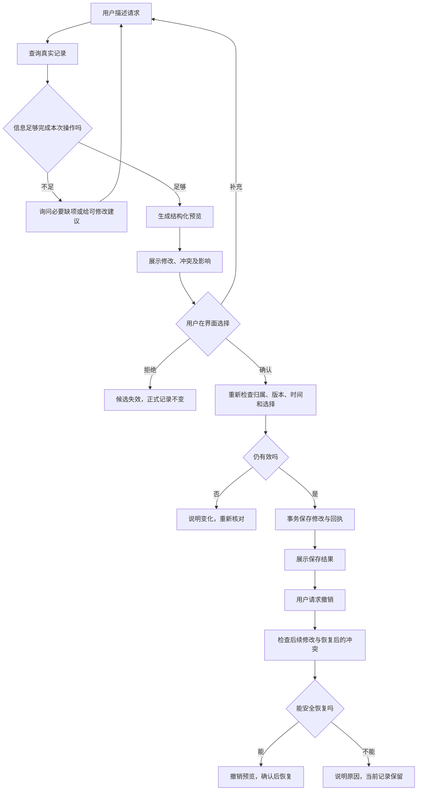
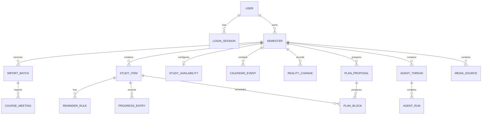
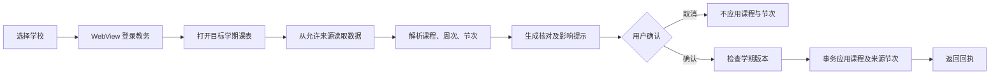

# 拾日技术方案

编写日期：2026 年 10 月 10 日

软件版本：1.1.0，构建号 11

代码依据：`main` 分支提交 `15f0d577da3d3308709c67fa406028363f8241dd`

编写依据：《2026 AIC 算法创新赛赛题规则汇总》“五、技术方案参考大纲”。

本文按参考大纲的六部分及全部小项编写，说明拾日已经实现的功能、实现方法和验证结果。代码、配置和保存的测试记录是事实依据；产品目标、后续计划与已完成工作分别说明。“待补”表示目前没有足够材料，不能作为已经取得的成果。

## （一）产品概述与定位

### 1. 背景与目标

学生每天需要处理的信息分散在不同地方：课程在教务系统里，会议和活动通过群消息发布，作业可能只有一句截止要求，个人复习计划又记在其他工具中。记录一条通知时，用户往往还要打开课表检查冲突，再到待办工具设置提醒。通知发生变化后，这些地方还需要分别更新。

拾日围绕这个问题设计。它把课程、一般日程、待办和学习安排放在同一个学期中，让用户既能手动记录，也能用日常语言查询和修改。例如，用户说“明天上午九点有个会”，软件需要理解这句话，还要查明天的课程、识别九点是否冲突，并让用户决定怎样处理。只生成一段听起来合理的回答，不能完成这件事。

大模型的工具调用能力，为这种交互提供了技术基础：模型可以把语言请求转成指定工具的参数，再根据工具返回的信息回答。拾日采用这一方式，把语言理解与实际的数据操作连接起来。模型负责理解表达，程序负责核对对象、计算时间和控制保存。这也是项目在 AI 软件应用上的探索方向。[DeepSeek 工具调用文档](https://api-docs.deepseek.com/guides/tool_calls/)

项目的具体目标有三项：

1. 让学生能够从一份课表和一条通知出发，完成记录、冲突核对、提醒和后续修改。
2. 接受现实中常见的不完整信息。只有开始时间、只有日期、没有截止时间的内容，都应能先记录；需要安排具体时间时，再补充真正必要的信息。
3. 让 AI 的修改可以检查。用户看到将保存什么、影响哪些安排，确认后才写入；保存后有结果记录，符合条件的操作可以撤销。

本项目定位于个人校园事务管理，不替代学校教务系统，也不办理或审批请假。它记录用户自己的日程与选择，帮助用户发现冲突和安排个人任务。

**待补：**目前没有正式的用户访谈记录、问卷统计或长期使用研究。以上需求来自项目开发中提出的问题和场景，不能写成“已通过大样本调研证明的市场需求”。

### 2. 产品定位

拾日是一款面向在校学生的 AI 辅助日程与学习安排应用。目前交付和验证的移动端为 Android；虽然采用 Flutter，本文不将其他平台写成已经完成验收的产品。

| 定位项目 | 当前情况 |
| --- | --- |
| 产品类型 | 将大模型、规则检查和约束求解结合的校园个人管理应用 |
| 主要用户 | 需要同时管理课程、作业、考试、会议活动和个人学习安排的学生 |
| 核心 AI 功能 | 理解自然语言请求、整理通知、查询已有记录、生成修改预览、调用学习排程工具 |
| 主要使用场景 | 开学整理课表、收到新通知、检查时间冲突、查找空闲、安排任务、应对临时变化 |
| 当前交付 | Android 安装包、Python 服务端、部署配置、自动化测试及部分模拟器验证材料 |

应用有四个主要页面：“今日”查看当前和近期事项；“日程”查看周课表和按天分组的安排；“任务”管理需要完成的事情及个人学习计划；“学期”查看学期进度、考试和重要节点。助手是这些页面共用的操作入口，手动表单仍然保留。

项目希望形成的差异主要体现在场景适配和数据处理上：课程按周次、星期和节次展开，临时请假落在具体课次；通知中的活动时间、任务截止和本人参与情况分别记录；个人排程同时考虑课程、已预留活动、学习时段和固定计划。

这些是已经实现的设计特点。关于“理解更准确”“运行更快”“更受学生欢迎”等比较性结论，目前没有足够的对照数据，本文不作此类宣称。

## （二）技术架构与创新

### 1. 整体架构

拾日由手机端、API 服务、后台工作进程、数据库和媒体文件存储组成。文字助手调用外部大模型接口；图片识别和录音转写由服务端工作进程中的模型执行。学习排程由服务端调用 OR-Tools 计算。



“受限工具调用”表示模型只能选择程序已经定义的工具，不能自行执行 SQL、访问任意文件或调用确认保存接口。参数由 Pydantic 校验，查询和修改仍要检查当前账号及学期。

| 模块 | 输入 | 输出与职责 | 主要源码 |
| --- | --- | --- | --- |
| 客户端 | 操作、文字、图片、录音 | 页面展示、核对、确认、缓存和本地提醒 | `apps/mobile/lib/` |
| 学校导入 | 已登录网页中的课表 | 标准课程、来源学期和核对提示 | `features/import/`、`assets/*_reader.js` |
| API | 已认证请求 | 业务查询、候选记录、确认结果 | `services/api/app/main.py` 及业务路由 |
| 助手执行 | 请求、时间、对话和查询结果 | 工具调用、事实回答、待确认预览 | `agent_runtime.py`、`agent_tools.py` |
| 时间与冲突检查 | 课程、活动、考试、学习时段和计划 | 已知占用、开始点、冲突和信息缺口 | `capacity.py`、`fixed_conflict_guard.py` |
| 排程器 | 空档、剩余量、截止、原计划 | 新安排或重排候选，不直接保存正式计划 | `scheduler.py`、`replanner.py` |
| 媒体识别 | 清理后的图片或录音 | 可核对的文字及识别信息 | `media_recognition.py`、`media_jobs.py` |
| 持久化 | 业务数据、状态、版本和回执 | 数据保存、任务恢复、重复提交检查 | `models.py`、Alembic 迁移 |

助手请求先保存为数据库中的执行记录，再由后台进程处理。处理进度和工具结果也会保存。媒体识别由同一后台进程处理，但有独立的任务记录和领取逻辑。当前使用数据库任务队列，没有部署 Redis、消息中间件或向量数据库。

正式部署配置使用 PostgreSQL。部分历史场景实验使用独立 SQLite，以隔离合成数据；涉及行锁和并发的回归另在 PostgreSQL 中执行，两类结果不能相互替代。

### 2. 技术选型

下表按当前实现说明选择理由，不代表已经测得优于所有替代方案。

| 技术 | 用途 | 选择理由及使用边界 |
| --- | --- | --- |
| Flutter、Dart | 页面、表单、课表、动效 | 共用组件统一展示，通过插件连接系统服务；目前主要验证 Android |
| Riverpod、go_router | 状态和导航 | 管理数据刷新、页面状态与跳转，支持相应行为测试 |
| FastAPI、Pydantic | API、输入校验、错误返回 | 明确接口和工具参数，让错误定位到具体字段 |
| SQLAlchemy、PostgreSQL、Alembic | 数据、事务、行锁和升级 | 保存归属、版本、候选和回执，相关修改可一起提交，结构通过迁移维护 |
| LangGraph | 模型与工具执行流程 | 明确组织“调用模型—执行工具—继续回答或等待确认”；执行状态另存项目数据库 |
| DeepSeek 兼容接口 | 理解语言、选择工具、回答 | 接入现有业务工具；模型名和地址可配置，代码默认及历史文字实验记录为 `deepseek-flash` |
| OR-Tools CP-SAT | 新增排程与重排 | 将时间范围、不重叠、时长等表达为可检查的约束，并保留求解状态 |
| RapidOCR、ONNX Runtime | 服务端图片识别 | 将截图转成文字，再交给用户核对及助手整理 |
| sherpa-onnx、SenseVoice | 服务端录音转写 | 录音转文字后共用整理流程；当前配置使用 CPU 推理 |
| flutter_local_notifications | Android 提醒 | 交给系统调度，根据权限采用精确或非精确方式 |
| Docker Compose、Nginx | 部署、HTTPS | 分别管理数据库、迁移、API 和工作进程，便于固定依赖与升级 |

依赖锁文件记录了 LangGraph 1.2.12、OR-Tools 9.15.6755、RapidOCR 3.9.2 等版本。版本来自项目文件，不能用网上最新版本代替实际版本。

技术机制分别参见[Flutter 架构说明](https://docs.flutter.dev/resources/architectural-overview)、[LangGraph 概述](https://docs.langchain.com/oss/python/langgraph/overview)和[CP-SAT 文档](https://developers.google.com/optimization/cp/cp_solver)。项目使用这些现有技术，没有将它们描述为自行研发的框架。

### 3. 创新应用

拾日的主要工作是将 AI 与校园安排的实际规则结合，没有训练新的通用大模型，也没有自行实现 OR-Tools 求解器。当前可说明的应用特点有四项。

**语言理解之后继续核对真实记录。** 用户说“那个会改到明天”时，助手查询已有对象，再判断是否还有歧义。准备保存前，程序重新检查账号、对象和版本。模型中的一句“已改好”不构成保存成功的依据。

**时间精度、时间含义和本人参与分开。** “周五有活动”“周五九点集合”“周五全天参加活动”对应不同信息。未知结束时间不补成一小时，也不占满整天；自愿活动尚未报名，可以保留为参考而不占用本人时间。

**课程参与排程约束，个人变化落实到具体课次。** 一次会议与课程冲突时，用户决定调整时间、记录已办理请假的课次或明确保留重叠。请假不删除整门课程，不影响之后各周。

**重排优先少动原计划。** 在满足约束的前提下，依次减少被移动的任务数、总移动分钟数，再考虑较早安排。三个小规模合成场景中，这种目标比“只追求尽早安排”移动更少，详见第（四）部分。

与其他工具的比较采用公开功能说明，目前没有同条件竞品实测。

| 对照对象 | 公开功能重点 | 拾日在本项目中实现的场景重点 |
| --- | --- | --- |
| Microsoft To Do | 清单、截止、提醒、共享列表与每日建议 | 结合课程和预留活动，生成任务学习时间候选 |
| Google Calendar | 日历管理、共享日历、预约安排等 | 按周次和节次组织课程，记录具体课次的请假、停课和调课 |

依据为[Microsoft To Do 官方介绍](https://www.microsoft.com/en-us/microsoft-365/microsoft-to-do-list-app)与[Google Calendar 官方介绍](https://workspace.google.com/products/calendar/)。这里比较产品重点，不据此判断其他产品“不能实现”某项功能，也不宣称拾日在准确率、速度或市场表现上领先。

**待补：**同类校园应用的实际对照、统一测试任务、比较版本及完整结果；专利等创新性证明材料目前未提供。

## （三）功能设计与实现

### 1. 核心功能

#### 1.1 自然语言查询与通知整理

用户可以直接提问或提供通知。文字直接进入助手；图片和录音先由识别模块转成文字，用户可以核对，再继续整理。

助手结合当前时间、所属学期、必要对话和页面浏览范围处理请求。当前请求与通知原文中的相对日期各有参照信息，不能把旧通知里的“明天”一律解释为提问当天的明天。同名事项先按名称、日期或地点搜索，仍无法定位时再问。

| 工具类型 | 例子 | 行为 |
| --- | --- | --- |
| 查询 | `query_calendar`、`find_records`、`query_course_occurrences`、`find_free_windows`、`query_insights` | 返回真实记录或计算结果，不修改正式日程和计划 |
| 准备修改 | `prepare_event`、`prepare_item`、`prepare_item_change`、`prepare_course_change`、`prepare_plan`、`prepare_undo` | 生成可核对的候选，等待界面确认 |

一份通知包含多项行动时，`prepare_batch` 生成分组预览，用户选择要保存的分组。当前最多包含 8 项操作。每一项的材料、渠道、时间和接收者分别归属，不能把其中一项的条件复制给所有事项。

本人职责需要单独判断。例如，“班长选两人参加会议”不表示班长本人参会；通知发布者说“我已交材料”也不表示当前用户已经完成。这些要求写在助手规则中，并由部分通知场景检查。模型仍可能理解错误，结构化预览用于最后核对。

#### 1.2 时间记录与冲突处理

时间对象支持 `exact`、`date`、`week`、`range`、`unknown` 五种精度，另行记录“开始”“截止”“办理窗口”“候选日期”“全天”等含义。具体时刻使用带时区的值，校园时间按 `Asia/Shanghai` 解释。

| 已知信息 | 记录方式 | 对冲突与排程的影响 |
| --- | --- | --- |
| 明天 09:00 开会，结束没说 | 开始时刻，结束留空 | 检查开始点及明确的提前到场要求，后续占用长度仍未知 |
| 明天 09:00—10:00 开会 | 明确起止时间 | 本人需要参加且预留时，按占用区间检查重叠 |
| 周五有活动，几点没说 | 日期精度 | 不视为全天占用，保留补时间提示 |
| 周五全天参加活动 | 明确全天含义 | 按已声明的全天占用处理 |
| 本周可以去办理 | 办理窗口 | 是可办理范围，不是持续占用或自动推定的硬截止 |
| 有空整理资料，截止没定 | 无期限待办 | 可以记录；排程时使用已确认的剩余量和开始条件 |
| 自愿活动，尚未报名 | 参考安排及参与状态 | 不因记录通知自动预留本人时间 |

只有开始时间的活动，既不能证明“开始之后一直有空”，也不能证明“直到当天结束都没空”。程序保留不确定提示；开始点落在课程内时，可以明确指出这一处冲突。明确结束时间后，才形成相应完整区间。

固定安排保存前会计算新增冲突和受影响的个人计划。用户可以修改时间、选择已请假的冲突课次，或明确保留重叠。没有明确处理的已知冲突会阻止直接保存。“已请假”是个人记录，不代替学校审批。

已请假课次保留原数据和变化记录，客户端的当前日程及周视图不再将它作为需要上课的安排展示，其他周次保持原状。

#### 1.3 空闲查询

“明天下午有没有空”默认查询普通日程空档，扣除已知课程、预留活动、考试、个人计划和临时不可用时段。“有没有一小时可以学习”使用已保存的学习时段，再扣除占用。

普通查询没有指定每日范围时默认 08:00—22:00；用户明确全天或其他时间时使用相应参数。这个默认值不是用户生活习惯的事实。信息不完整的安排同时返回核对提示，不能保证未知结束时间的活动不会影响所列空档。

#### 1.4 新增学习安排

输入包含任务剩余分钟数、是否可拆分、最早开始条件、明确截止、学习时段、不可用时段，以及课程、活动和原计划。

1. 展开实际课次，将已知占用区间合并，从学习时段中扣除。
2. 检查任务开始条件、剩余量和原计划有效性，扣除已安排工作量。
3. 可拆分任务按单次时长分段，需要一次完成的任务保留连续时长。
4. 为分段建立允许开始范围，要求各段互不重叠。
5. 调用 CP-SAT 求解，再独立校验区间、时长、截止和总量。
6. 返回候选，用户确认后才保存正式计划块。

默认要求完整安排。用户明确允许部分安排时，可以给出部分方案，但说明多少分钟未安排。默认单次时长为 45 分钟，可调整；它不是每项任务的预计耗时。

记录任务不强制填写耗时和截止，安排具体时间则依赖所需时长。缺耗时时可以给出可修改的建议供确认，不能将建议当成原始事实。普通任务没有明确等待条件时可以从现在开始；“等审批后再做”等条件保留。

当前先固定分段再求解。某种分段长度放不进去，会说明原因或建议缩短单次时长；这不等于已证明所有可能的分段方式都无解。

#### 1.5 临时变化后的重排

新活动不会悄悄挪动已保存的学习计划。用户要求重排后，只调整允许移动的个人计划；排程器不自动改课程、考试和固定活动。

重排保留计划块身份和时长，锁定、已开始、即将开始及未选中的计划固定。如果固定部分已与现实安排冲突，先由用户处理，不能自动解锁或删除工作量。

满足约束后，程序依次优化：被移动的任务数最少；所有计划块开始时间绝对移动分钟数之和最少；前两项相同时，再倾向较早安排。一个任务有多段时，任一段移动即计入该任务。

只有证明某阶段最优，才固定其目标值继续下一阶段。预算耗尽而只得到可行解时保留相应状态，不能写成已证明全局最优。

#### 1.6 确认、回执与撤销



确认检查预览令牌、学期版本及用户选项。重复提交同一确认返回已有结果；同一确认换成另一组选项不能覆盖先前结果。业务修改与回执在一个事务内保存。

撤销也检查现状。例如旧时间已被新活动占用，恢复会重新制造冲突，就不能直接恢复。撤销对应本次操作，不清空之后全部修改。

### 2. 辅助功能

| 功能 | 当前实现 | 与 AI 的协作关系 |
| --- | --- | --- |
| 账号与恢复 | 注册、登录、会话刷新、退出、恢复码重置；Argon2 密码哈希 | 工具只访问当前账号，不由模型选择其他用户 |
| 学期与课表 | 起始周一、周数、节次、课程导入及手动编辑 | 为日期、课次和排程提供基础数据 |
| 学校适配 | 河南工业大学、黑龙江大学适配器，登录在客户端 WebView 完成 | 解析实际网页字段，不依赖模型猜课程 |
| 日程与任务 | 手动新增、编辑、完成、取消、恢复、分类和标签 | 共用业务数据和规则；AI 不可用时保留手动入口 |
| 统计 | 安排数量、已排时长、重叠去重占用、缺失信息及进度记录 | 与页面共用统计接口，不生成虚构效率分数 |
| 本地提醒 | 同步账号提醒，系统调度，核对本地状态后可离线延后 10 分钟 | 延后是本机操作，正式完成仍由服务端校验 |
| 历史对话 | 查看、继续、修改输入和删除 | 删除后正常历史入口不展示，待处理预览失效，已保存业务记录保留 |

河南工业大学 10 节时间按用户截图预填，随课程确认应用；取消导入不提前改变节次。编辑页直接展示全部行。该时间来源是用户资料，本轮未重新向学校核实作息。

缓存支持减少重复读取和有限离线行为，不是完整离线写入系统。模型请求、排程、正式保存及任务完成需要连接服务端。

### 3. 扩展性设计

| 扩展位置 | 现有实现 | 扩展时需保留的检查 |
| --- | --- | --- |
| 模型 | `agent_model.py`、`text_model.py` 封装调用，地址、模型名、凭据可配置 | 新服务须支持所用协议，重测工具、流式输出、错误和日期 |
| 工具 | 名称、输入模型、说明和执行分派集中定义 | 保留归属、参数校验、预览和确认边界 |
| 学校 | `SchoolAdapter` 区分地址、来源、脚本和解析器 | 验证真实网页、字段、周次、节次及登录变化 |
| 识别 | 图片、录音先转文字，共用整理流程 | 更换模型后测试文本及字段质量，不直接保存识别结果 |
| 排程 | 输入准备、求解、校验、保存分开 | 修改策略仍检查时长守恒、固定计划及确认前不写入 |
| 数据 | Alembic 迁移与版本检查 | 先备份，再在隔离环境验证迁移和旧数据 |

其他兼容模型、更多学校和分段策略改进属于后续计划。当前没有多模型自动择优、自训意图模型、向量知识库或团队协同排程。

**待补：**模型间统一评测、新学校真实导入验证，以及扩展后的成本和性能测试。

## （四）开发测试与部署

### 1. 开发流程

项目逐步实现功能，补充回归测试、模拟器检查和发布验证。以下日期依据 Git 提交，只表示相应工作已有提交，不表示完整工时、人员投入或全部验收完成时间。

| 日期 | 可核对的节点 | 记录依据 |
| --- | --- | --- |
| 2026-09-19 | 建立设计基线 | `dfacbd6` |
| 2026-09-20 | 导入、文字整理、学习时段、约束排程、临时变化处理陆续进入代码 | `7e32db5`、`b2d74c9`、`7789f43`、`779062a`、`dfe0ad1` |
| 2026-09-20 | 图片及录音识别、可核对的自然语言操作 | `1bad334`、`bc7ebcf` |
| 2026-09-27 | 持久化助手执行，与媒体来源、排程整合 | `9fd31a6`、`2d6b1ff` |
| 2026-10-07 至 10-08 | 口语查询边界、单课次请假、冲突确认、移动端改版 | `e6a8f59`、`a9f1d4d`、`048a8de` 等 |
| 2026-10-09 | 未知结束时间、请假展示及动效调整，整理 1.0.0 交付 | `b8867b3`、`23f1b93`、`98f5034` |
| 2026-10-09 至 10-10 | 保存真实模型文字场景、排程、模拟器及算法对比证据 | `验证证据/aic-20261009/` |
| 2026-10-10 | 上传、认证、离线延后、节次预填和导入返回修复，更新构建号 9 | `15f0d57`、`验证证据/fixes-20261010/` |

代码使用了 AI 辅助开发与检查，但生成代码本身不是质量证明。数据库规则和手机行为通过测试、实际运行与结果读取来核对。

| 工作范围 | 仓库中可确认的内容 | 人员信息 |
| --- | --- | --- |
| 产品与场景 | 页面、业务规则和场景测试 | 负责人、参与成员待补 |
| 客户端 | Flutter、导入、缓存和提醒 | 负责人、参与成员待补 |
| 服务端与 AI | API、助手工具、识别、冲突和求解 | 负责人、参与成员待补 |
| 测试与部署 | 测试、模拟器证据、构建和部署工具 | 负责人、参与成员待补 |

**待补：**实际成员及分工、指导情况、投入工时，以及未被提交记录覆盖的研发过程。不根据 Git 作者或 AI 对话推断个人职责。

### 2. 代码实现

关键实现分为三层。

第一层是工具输入与查询。Pydantic 输入模型生成 JSON Schema，模型提交符合工具定义的参数。对象 ID 来自当前账号的查询结果，业务层继续验证归属，而非仅相信模型给出的 ID。

第二层是时间计算。新增排程建立时间变量和不重叠约束；重排逐级减少对原计划的影响。求解后再以普通程序检查时长、区间、截止、固定计划和总量。

第三层是事务保存。预览与正式记录分开；确认检查版本后一起提交修改和回执。撤销先计算恢复后的影响，再判断能否恢复。

为提高可靠性，当前实现还做了以下处理：

- 持久化助手及媒体任务保存进度、状态和领取信息，由后台进程处理，提交这些任务的 API 请求不直接等待整段推理。
- 上传先解码、清理文件，再进入数据库保存阶段；同步会话在工作线程中创建、使用和关闭，避免在事件循环等待行锁。
- 相关上传统一锁顺序，用户配额锁采用不妨碍外键引用检查的方式，减少交叉写入死锁。
- 登录验证后加锁重读密码状态，避免旧密码验证与密码重置交叉后留下会话。
- 刷新令牌提供短时重试回执，客户端先保存本次请求标识，响应丢失后重试同一次操作。
- 高风险认证与刷新、退出分别限流，减少校园共享出口下的相互影响。

这些措施针对具体异常与并发路径，大规模容量仍需单独测试。核心源码摘录见第（六）部分。

### 3. 测试优化

#### 3.1 方法与环境

测试分为程序回归、真实模型文字场景、算法对比和模拟器操作。场景使用独立测试账号及合成课程、任务，不是真实学生数据。真实模型场景调用实际接口，其他自动化测试可能采用可控输入或替身，因此测试通过数不是模型准确率。

历史助手及算法场景使用构建号 8、Android 13 x86_64 模拟器、独立 SQLite 和真实 `deepseek-flash` 接口。构建号 9 的可靠性修复另用真实 PostgreSQL 回归，并保存原生模拟器结果。本文引用这些已保存记录，本次文档重写没有重新运行业务实验。

| 范围 | 记录结果 | 可支持的结论与限制 |
| --- | --- | --- |
| 文字助手及业务 HTTP | 8 组通过 | 指定场景符合预期，不代表任意表达都正确 |
| 排程前提与拒绝候选 | 3 组通过 | 检查缺耗时、显式等待条件及拒绝候选 |
| 模拟器主线 | 9 组通过 | 界面与保存后读取互相核对，限该模拟器与样例 |
| 重排目标对比 | 3 组，每组 1 次 | 同输入下比较目标；样本不足以支持普遍优势 |
| 手动与助手录入 | 1 对任务，主要字段一致 | 支持该条记录一致性，不支持人均效率结论 |
| 构建号 9 PostgreSQL 全量回归阶段 | 544 通过、0 跳过，466.01 秒 | 耗时是整套测试时间，不是接口响应时间 |
| 随后最终锁顺序相关回归 | 35 通过，20.74 秒 | 与前项重叠，不相加为全量总数 |
| Flutter 全量回归 | 579 通过 | 客户端自动化结果，不替代全部真机验收 |
| Flutter 静态分析 | 无问题 | 保存记录中的结果 |
| 构建号 9 原生模拟器检查 | 节次预填、全部展示、返回、离线延后及普通进程退出后的延后通过 | 不保证不同手机或强制停止后的行为 |

全量 PostgreSQL 回归之后还有锁顺序细化及定向验证，本文按实际顺序列出，不将最终状态写成又重新完成了一次全量运行。

#### 3.2 AI 与业务专项用例

| HTTP 场景 | 主要检查点 | 结果 |
| --- | --- | --- |
| 手动记录只有开始时间的会议 | 09:15 与 09:00—10:00 课程冲突；结束为空；重复保存不重复新增 | 通过 |
| 活动与所选课次请假一起保存 | 非法选择全部回滚，合法选择只影响该课次 | 通过 |
| 旧预览确认 | 数据版本已变时拒绝，不写新活动 | 通过 |
| 真实模型处理会议、请假和撤销 | 开始时间预览、真实冲突、对应范围保存与撤销 | 通过 |
| 多项通知 | 提前集合与正式开始分开，未知结束和独立任务未知截止保留 | 通过 |
| 普通与学习空档 | 按不同范围计算，查询不改正式记录 | 通过 |
| 安排 150 分钟任务并撤销 | 避开课程，预览不写入，确认不重复，剩余量不变 | 通过 |
| 锁定下重排与撤销 | 少量移动、锁定及工作量保持，危险恢复拒绝 | 通过 |

三组补充用例验证：缺耗时仍可记录但不凭空排程；显式审批等待不能忽略；合法候选被拒绝后不生成正式计划，旧确认也不能应用。

九组模拟器主线覆盖：开始时间会议与单课次请假、补充结束时间、地点修改及限定撤销、两类空档查询、计划确认、锁定、活动加入后不自动重排、确认重排、拒绝会重新产生冲突的撤销。

#### 3.3 算法对比

对比只改变重排目标。两种方法使用相同合成输入、硬约束、工作量、锁定计划、校验、10 秒预算和 4 个求解线程。基线只追求较早开始，项目方法先少动任务、再少动时间、最后较早开始。在这三组输入上，两种方法均返回最优状态。

| 合成场景 | 项目方法移动任务数 | 基线移动任务数 | 项目方法移动分钟数 | 基线移动分钟数 |
| --- | --- | --- | --- | --- |
| 09:00 附近新增冲突，较晚计划锁定 | 1 | 2 | 60 | 240 |
| 11:00 附近新增冲突，末段计划锁定 | 1 | 2 | 60 | 300 |
| 原计划有效 | 0 | 2 | 0 | 420 |

每组都保留 180 分钟工作量及锁定计划。移动分钟数是各计划块开始时间移动绝对值的和，不是节省的学习时间。结果支持该目标在这些样例上产生预期效果，不证明大规模优势或速度优势。

模拟器另一条主线有三项任务、共 90 分钟。加入 19:30—20:00 活动后，仅“复习概率论”由 19:30—20:00 移至 20:30—21:00；锁定的“完成实验报告”保留 19:00—19:30，总工作量不变。它与上表的 180 分钟实验是不同数据。

#### 3.4 根据问题改进

| 问题 | 当前改进 | 已有验证 |
| --- | --- | --- |
| 普通空闲被限制在学习偏好内 | 两类查询分开 | 真实模型 HTTP 与模拟器 |
| 未知结束容易影响整天 | 只按已知区间、开始点和明确到场要求判断 | 开始时间冲突、单课次请假及补时间 |
| 活动与课程冲突却直接保存 | 返回冲突与处理选项 | 手动、助手和旧预览场景 |
| 新活动悄悄挪学习计划 | 活动保存与重排分开确认 | 保存前后读取对照 |
| 上传锁等待可能影响 API | 文件处理与短事务分离、线程内会话、统一锁顺序 | PostgreSQL 上传及交叉写入回归 |
| 密码重置与旧登录交叉 | 加锁重读密码后再建会话 | 认证竞态回归 |
| 刷新响应丢失后重登 | 120 秒同请求重试 | 认证及客户端回归 |
| 退出中某步失败后停住 | 独立清理、持久化退出标记和错误提示 | 客户端异常路径测试 |
| 断网不能延后提醒 | 核对账号和本机提醒后延后 | 断网及普通进程退出后的原生检查 |
| 节次手填和帮助导入无返回 | 预填随确认应用、全部行展示、返回路径保留 | 导入回归与模拟器 |

尚缺独立的大样本口语评测、OCR / ASR 准确率、多模型比较、多品牌手机、正式包启动与耗电，以及明确负载的并发压测。现有材料不含总体准确率、P95 接口延迟或可支持并发用户数。

### 4. 部署方案

#### 4.1 本地开发与验证

本地使用 Flutter SDK、Android SDK、JDK 21、Python 和 Docker。API 镜像基于 Python 3.12，数据库配置为 PostgreSQL 17。Python 依赖按 `requirements.lock`，Flutter 按 `pubspec.yaml` 和锁文件安装。

以下为项目根目录的 PowerShell 命令。需先准备数据库及所需模型配置，凭据不写入本文。

```powershell
# 启动本地数据库、安装依赖、迁移并运行 API。
powershell -File scripts/dev.ps1 -Action Api

# 另开终端连接或启动模拟器并运行客户端。
powershell -File scripts/dev.ps1 -Action Android

# 在测试环境运行现有回归入口。
powershell -File scripts/dev.ps1 -Action Test
```

本地 API 默认 8871 端口，Android 模拟器通过 `10.0.2.2` 访问宿主机。文字助手需要有效模型配置，图片和录音功能还需相应模型文件。没有模型服务时仍可手动记录。

测试使用隔离数据。重跑证据脚本前要核对参数和依赖，使用本地服务及新合成账号；历史执行文件不是对正式账号的操作指令。

#### 4.2 云端组成与配置

`deploy/compose.cloud.yaml` 定义数据库 `db`、一次性迁移 `migrate`、API `api`、后台进程 `worker`。API 与 worker 共用应用镜像、数据库和媒体卷，模型目录只读。Nginx 提供 HTTPS，API 端口只绑定服务器本机。

| 配置 | 作用 |
| --- | --- |
| `DATABASE_URL` | PostgreSQL 连接 |
| `DEEPSEEK_API_KEY`、`DEEPSEEK_MODEL`、`DEEPSEEK_BASE_URL` | 模型凭据、模型名、兼容接口地址 |
| `MEDIA_ROOT` | 共享媒体目录 |
| `RAPIDOCR_MODEL_DIR`、`SENSEVOICE_MODEL_DIR` | 只读识别模型位置 |
| `MEDIA_WORKER_MODE=external` | 使用独立 worker，API 不再启动内置 worker |
| `APP_TAG` | 固定应用镜像版本 |

部署顺序为：准备配置与模型 → 备份数据 → 构建或取得指定镜像 → 执行迁移 → 启动 API 和 worker → 检查健康状态及关键业务。仓库有 `deploy/deploy_cloud.py`、备份及恢复演练脚本，使用时按实际服务器设置参数。

2026 年 10 月 10 日保存的证据显示：API、worker 使用 `semesteros-api:v1.0.0-build9-r1`，迁移为 `0017_auth_and_import`，公开健康返回 `status=ok`、`version=1.0.0`、`database=postgresql`。这是历史验证记录，不保证阅读本文时仍为同一状态。

#### 4.3 数据、安全与运行边界

查询和写入检查账号归属，部分关系另有包含用户字段的复合外键。密码用 Argon2 哈希，会话令牌以哈希保存，客户端使用安全存储；密码重置撤销原会话。上传限制输入体积，解码清理后再保存。

上传路径将同步工作移入线程池，会话留在工作线程内。设计依据为[FastAPI 同步与异步说明](https://fastapi.tiangolo.com/async/)、[SQLAlchemy Session 说明](https://docs.sqlalchemy.org/en/20/orm/session_basics.html)、[PostgreSQL 行锁文档](https://www.postgresql.org/docs/17/explicit-locking.html)。这是相应路径的修复，数据库并未整体改为异步访问。

当前只有一个 API 服务和一个 worker，没有多实例高可用。进程内限流和排程计数主要适用于当前部署；多实例前需统一规则并验证容量。Compose 的资源限制是配置，不是压测结果。

仓库有每日 03:30（Asia/Shanghai）备份 timer、完整性检查和恢复演练工具。配置存在不等于任务一直启用；正式运行要查看执行记录和备份可恢复性，尚不承诺特定恢复时间。

外部模型会收到请求需要的文字上下文及工具结果。图片和录音在服务端识别，不是手机离线推理。正式推广需补齐数据告知、保留周期和删除政策。对话入口删除也不等于所有业务记录及备份立即物理擦除。

Android 提醒由系统调度，无精确闹钟权限时用非精确方式，可能延迟。普通后台退出与设置中的“强制停止”不同，不将前者验证推广到后者。参见[Android 闹钟文档](https://developer.android.com/develop/background-work/services/alarms)。

构建脚本检查签名和包内容，当前脚本默认使用 Android 调试密钥库。正式上架所需的专用发行密钥、访问控制和保管流程仍待补齐，可安装升级不能替代这些流程。

## （五）应用价值与展望

### 1. 应用场景

**收到只有开始时间的会议通知。** 用户输入“明天 09:15 开会”。软件保留未知结束，检查与课程的关系并展示冲突。用户修改时间或记录某课次已请假，确认后保存；之后补结束时间时更新原活动。这条流程已在合成 HTTP 和模拟器中检查，只影响所选课次，不代替学校审批。

**一份通知同时有活动和材料提交。** 助手分别预览分项，保留地点、渠道和已知期限。活动结束留空，材料截止未知时也不借活动时间作为截止，用户选择相关组保存。

**结合课表安排学习。** 确认学习时段和剩余量后计算候选。历史 HTTP 用例安排了 150 分钟并避开固定课程，模拟器主线确认了三项任务共 90 分钟。它们证明对应输入可行，不表示每组任务都能排下。

**临时加入活动后少改计划。** 用户固定不能移动的部分，再调整其余计划。模拟器主线只移动一项任务 60 分钟，总工作量和锁定项保留；价值在于变化范围明确，不是节省了 60 分钟。

**断网延后提醒。** 手机核对账号和本机通知后延后 10 分钟，不先请求服务器。模拟器证据覆盖断网及普通后台进程退出，其他手机和电量策略仍需验证。

手动与助手录入的唯一一对合成待办中，主要字段一致，自动化宏步骤为手动 9 步、助手 5 步。这是按预先口径统计的点击及输入动作，不是人的完成时间，不能据此计算提效百分比。

**待补：**经用户同意的对照试用，记录成功率、错误类型、纠错次数和完成时间，再评价实际收益。

### 2. 市场分析

项目选择学生个人作为直接用户。通用日历和待办已有成熟产品，其公开说明也有智能建议、共享和预约等功能。拾日需要说明在校园课程与通知处理中解决了什么具体问题，“加入 AI”本身不足以说明竞争力。

本项目的产品判断是：将周次课表、通知中的个人职责和临时变化放入同一套规则，可能减少来回核对。这个判断来自所针对的操作过程，市场接受度仍需要代表性研究。

| 分析方面 | 现有依据 | 仍缺信息 |
| --- | --- | --- |
| 目标用户 | 学生个人课程与事务管理场景 | 年级、专业、地区差异及访问样本 |
| 竞争格局 | 公开日历、待办功能与项目重点对照 | 校园产品完整调研、同任务实测 |
| 算法竞争力 | 三组合成重排支持减少改动，时间和工作量可检查 | 大样本、多模型和规模变化比较 |
| 功能与体验 | 课程、通知、任务、排程、提醒连贯流程及模拟器证据 | 满意度、留存、长期使用、无障碍实测 |
| 运营成本 | 模型、服务器、识别及逐校维护均有成本 | 单用户调用量、单次成功成本及月度记录 |
| 推广条件 | 需要可靠适配、数据告知、发行签名和真机质量 | 试点用户、学校、渠道和合作证明 |

从公开产品说明能确认，日程与任务工具已有智能辅助功能；这不足以推算行业增长率、付费意愿或拾日市场份额。当前没有可靠市场规模测算。

**待补：**带出处和年份的市场规模、访谈、竞品试用、付费意愿及成本数据。不填写未经验证的收入和增长率。

### 3. 成果总结

项目已形成 Android 应用与服务端，覆盖学期课程、日程、任务、助手、排程和提醒。AI 已连接真实查询和预览工具，部分文字场景调用真实模型，并核对保存后的记录。

主要成果为：未知时间可保留，冲突按已知事实处理；请假落实到课次；求解候选经确认后保存；重排保留工作量及锁定项；版本、重复提交、回执和撤销规则贯穿保存流程。仓库还保留测试证据、构建、部署、迁移和备份恢复工具。

开发中的一个经验是，把“尚未说清”与“已经知道存在冲突”分开。前者保留原话并提示核对，后者在保存前由用户处理。另一个经验是，自然的 AI 回复与正确的保存结果需要分别验证，必须检查字段与最终记录。

目前没有可引用的真实用户试点效益、专利、软著证书或第三方检测报告。本文成果指软件实现与限定范围的验证。

### 4. 未来规划

以下按完成条件列出方向，未确认的上线日期和投入不填写。

| 方向 | 当前不足 | 后续工作及完成依据 |
| --- | --- | --- |
| 语言理解 | 样例有限，复杂职责及多义表达可能误解 | 建匿名独立样本，分开统计理解、查询、预览、保存错误 |
| 图片与录音 | 有实现，现有文字实验未覆盖识别质量 | 测模糊、长截图、噪声、口音，记录文字及字段误差 |
| 排程 | 固定分段可能限制解，复杂规模缺测试 | 比较分段策略及任务数、跨度、锁定比例变化，保留校验 |
| 并发与成本 | 单 API、单 worker，缺容量报告 | 测队列、延迟、资源和费用，再决定扩容 |
| 学校覆盖 | 逐校维护，网页变化影响适配 | 经授权的真实导入回归，记录版本并持续核对节次 |
| 手机质量 | 主要证据为模拟器 | 补品牌、系统、权限、弱网、后台、电量策略检查 |
| 数据与发行 | 告知、周期及生产密钥材料不全 | 完成数据流、删除政策、专用签名及依赖和素材许可证清单 |
| 实际价值 | 无代表性真人对照 | 经同意比较相同任务，保留失败与原始统计 |

## （六）附录

### 1. 软件设计资料

#### 1.1 主要数据关系

图中省略别名、部分修订表和索引，完整字段及约束以 `services/api/app/models.py` 和迁移文件为准。



`CourseMeeting` 保存课程模板，实际课次由周次、星期、节次和变化记录展开，不为每周提前创建独立的课程行。`StudyItem` 保存任务、作业、考试等，`CalendarEvent` 保存一般日程，`PlanBlock` 则是个人学习安排。

学期 `revision` 检查预览期间其他修改，记录 `version` 检查该对象变化。候选、回执、修订及执行状态区分“算过”“待确认”“已保存”“已撤销”。

#### 1.2 学校导入流程



源码包括 `school_adapters.dart`、`haut_parser.dart`、`hlju_parser.dart`、网页读取脚本，以及服务端 `academics.py`、`school_periods.py`、`import_extras.py`。学校字段不同，由适配器解析，不让模型补造课程。

#### 1.3 关键参数

下列是当前默认值或保护上限，不是经过压测得出的最佳参数或容量。

| 参数 | 当前值 | 来源及含义 |
| --- | --- | --- |
| 学期总周数 | 1—30 周 | `SemesterInput` |
| 每日节次数 | 1—30 节 | 学期节次输入校验 |
| 校园时间 | `Asia/Shanghai` | 日期解释、显示、课次计算 |
| 时间精度 | exact / date / week / range / unknown | `ItemTime`，允许起止信息不完整 |
| 排程范围 | 默认 7 天，允许 1—210 天 | `ScheduleInput`，还限制在学期内 |
| 开始预留 | 默认 5 分钟，允许 0—1440 分钟 | `lead_minutes`，避免刚生成就开始的候选 |
| 单次分段 | 默认 45 分钟，允许 1—1440 分钟 | `chunk_minutes`，不等于任务总耗时 |
| 部分排程 | 默认 false | 不默默丢掉排不下的工作 |
| 单次任务及计划 | 最多 100 项任务、300 段相关计划 | 求解前保护 |
| 求解预算 | 约 10 秒总预算 | 新增及重排相应阶段共用 |
| 求解线程 | 4 | CP-SAT 配置，不是 API 并发数 |
| API 排程槽位 | 当前单进程 2 个，同用户互斥 | `schedule_api.py`，不代表系统已测吞吐量 |
| 助手工具调用 | 一次运行累计最多 12 次 | `agent_runtime.py` |
| 批量操作 | 最多 8 项 | `prepare_batch` |
| 单图 / 录音体积 | 通用来源接口 10 / 20 MiB | `media.py`，助手组合上传另有检查 |
| 访问 / 刷新期限 | 900 秒 / 7 天 | `auth.py` |
| 刷新重试回执 | 120 秒 | 绑定旧令牌及同一请求标识 |
| 离线延后 | 10 分钟 | 核对当前账号与本机提醒后执行 |

河南工业大学预填时间如下，来源为用户截图，保留不同课长。

| 节次 | 开始 | 结束 | 节次 | 开始 | 结束 |
| --- | --- | --- | --- | --- | --- |
| 1 | 08:30 | 09:15 | 6 | 15:20 | 16:05 |
| 2 | 09:20 | 10:05 | 7 | 16:25 | 17:10 |
| 3 | 10:25 | 11:05 | 8 | 17:15 | 18:00 |
| 4 | 11:10 | 12:00 | 9 | 19:30 | 20:15 |
| 5 | 14:30 | 15:15 | 10 | 20:20 | 21:05 |

#### 1.4 设计资料索引

| 资料 | 路径 | 用途与范围 |
| --- | --- | --- |
| 架构、流程及关系图 | 本文第（二）1、（三）1.6、（六）1.1—1.2 节 | 当前主要结构和处理过程 |
| 完整模型及迁移 | `services/api/app/models.py`、`services/api/alembic/versions/` | 完整字段、关系和升级依据 |
| 客户端 | `apps/mobile/lib/features/`、`apps/mobile/lib/core/` | 页面、缓存、接口及账号状态 |
| 视觉规则和组件 | `design-system/shiri/MASTER.md`、`design-system/shiri-v2/`、`apps/mobile/lib/ui/` | 展示与无障碍规范 |
| 独立设计资料 | [拾日软件设计资料初稿.md](拾日软件设计资料初稿.md) | 补充文件，更新时间与范围需单独核对 |

### 2. 核心代码

以下摘录来自当前源码，换行和缩进为便于阅读作了整理，依赖上下文，不能单独运行。解释写在代码外，没有将示意代码当作生产实现。

#### 2.1 工具输入协议

来源：`services/api/app/agent_tools.py` 的 `tool_definitions()`。

```python
def tool_definitions():
    return [{'type': 'function', 'function': {
        'name': name,
        'description': description,
        'parameters': cls.model_json_schema()
    }} for name, (cls, description) in SCHEMAS.items()]
```

参数来自输入模型，不是自由文本约定。执行时继续检查工具名、JSON 和字段；注册表没有提供确认保存接口。

#### 2.2 新增排程约束与预算

来源：`services/api/app/scheduler.py` 的 `generate()`。语句位于计划段变量创建之后。

```python
model.add_no_overlap(intervals)
if optional:
    model.maximize(sum(earned))
else:
    model.minimize(sum(early))
solver = cp_model.CpSolver()
solver.parameters.max_time_in_seconds = max(
    .01, 10 - (time.monotonic() - started))
solver.parameters.num_search_workers = 4
status = solver.solve(model)
```

允许开始范围在前面的准备中已经扣除课程占用、考虑开始与截止。这里约束学习段之间也不重叠。部分安排优先选择按时长和优先级计分的工作，完整安排优化较早完成，后面仍校验结果。

#### 2.3 重排逐级优化

来源：`services/api/app/replanner.py` 的 `generate()`，两处节选。

```python
objectives = [
    ('moved_tasks', sum(task_moves)),
    ('shift_minutes', sum(offsets)),
    ('earlier', sum(variables))
]
```

```python
if status != cp_model.OPTIMAL:
    break
model.add(objective == round(solver.objective_value))
if name == 'earlier':
    optimal = True
```

按目标顺序求解，只有证明本阶段最优，才固定其值继续下一阶段，避免随意加权混淆“少动一项任务”与“早几分钟”。

#### 2.4 重复确认与事务

来源：`services/api/app/agent_api.py` 的 `decide()`，两处节选。

```python
if row.status == 'applied' and body.decision == 'confirm':
    if row.state.get('decision_signature', signature) != signature:
        error(409, 'IDEMPOTENCY_CONFLICT',
              '这次操作已按先前的选择保存，请查看结果')
    return public_run(row)
```

```python
owned_semester(db, user, preview['semester_id'], lock=True)
```

重复确认不能变成另一种修改，随后加锁取得当前账号的学期。完整函数调用 `apply_with_course_leave()`，记录对应撤销信息、保存回执，最后一次 `db.commit()`。预览版本、课次选择和具体规则在应用过程中继续检查。

### 3. 测试数据

#### 3.1 原始记录与结果

| 资料 | 路径 | 内容 |
| --- | --- | --- |
| 历史环境 | [environment.json](验证证据/aic-20261009/environment.json) | 构建号 8、模拟器、SQLite、真实模型及范围 |
| HTTP 主场景 | [backend-report.json](验证证据/aic-20261009/backend/backend-report.json) | 8 组及逐项请求返回 |
| 前提与拒绝 | [prerequisites-report.json](验证证据/aic-20261009/backend/prerequisites-report.json) | 3 组补充 |
| 模拟器 | [ui-report.json](验证证据/aic-20261009/ui-report.json)及同目录 `ui/` | 9 组界面和读取检查 |
| 算法对比 | [replan-ablation.json](验证证据/aic-20261009/backend/replan-ablation.json) | 输入、两种目标、求解状态、校验和移动量 |
| 手动 / 助手 | [comparison-report.json](验证证据/aic-20261009/comparison/comparison-report.json) | 预登记口径、字段、自动化动作 |
| 构建号 9 汇总 | [results.json](验证证据/fixes-20261010/results.json) | 回归、原生、云端、安装包 |
| PostgreSQL 全量 | [backend-full.txt](验证证据/fixes-20261010/backend-full.txt) | 544 通过、0 跳过 |
| 最终锁顺序 | [backend-lock-order.txt](验证证据/fixes-20261010/backend-lock-order.txt) | 随后 35 通过，不与全量相加 |
| Flutter | [flutter-result.txt](验证证据/fixes-20261010/flutter-result.txt) | 579 通过 |
| 原生提醒 | [offline-snooze-native.json](验证证据/fixes-20261010/offline-snooze-native.json)、[offline-snooze-cold.json](验证证据/fixes-20261010/offline-snooze-cold.json) | 断网及普通后台进程退出后延后 |
| 云端 | [cloud-verification.json](验证证据/fixes-20261010/cloud-verification.json) | 当时镜像、迁移、源码匹配和健康状态 |

目录中另有脚本和哈希清单，便于核对原文件。有些早期截图仍处于处理阶段，不能证明候选已渲染；候选内容由 JSON 读取支持，稳定界面使用后续截图。

#### 3.2 运行数据与缺口

三组合成重排的单次 `elapsed_ms` 如下，不含模型、网络、排队、页面和数据库保存。

| 场景 | 项目方法 | 较早安排基线 |
| --- | --- | --- |
| 09:00 附近冲突 | 313 ms | 15 ms |
| 11:00 附近冲突 | 47 ms | 16 ms |
| 原计划有效 | 47 ms | 15 ms |

这些只是在小输入上的一次运行。项目方法在这组记录中耗时更长，不能宣传为更快，也不能推算生产接口平均延迟或 P95。

| 缺少的数据 | 需要补充的内容 |
| --- | --- |
| 模型总体表现 | 独立样本、标注、失败分类、重复次数和分模块结果 |
| OCR / ASR | 原图或录音、核对文字、识别及字段误差 |
| 性能与容量 | 设备规格、负载、并发方式、延迟分位数、资源和错误率 |
| 用户成效 | 经同意的试用、样本范围、真实耗时、纠错次数 |
| 长期运行 | 提醒、后台、备份、故障及恢复记录 |

### 4. 参考文献

主要依据为源码、已保存证据及以下官方资料。网页核对日期为 2026 年 10 月 10 日，公开说明不代替本项目验证。

1. 2026 AIC 算法创新赛赛题规则汇总，“五、技术方案参考大纲”，规则页码 9—10。[规则 PDF](../2026AIC算法创新赛赛题规则汇总260506-1.pdf)。
2. Flutter. [Flutter architectural overview](https://docs.flutter.dev/resources/architectural-overview).
3. FastAPI. [Concurrency and async / await](https://fastapi.tiangolo.com/async/).
4. SQLAlchemy. [Session Basics](https://docs.sqlalchemy.org/en/20/orm/session_basics.html).
5. PostgreSQL 17. [Explicit Locking](https://www.postgresql.org/docs/17/explicit-locking.html).
6. LangChain. [LangGraph overview](https://docs.langchain.com/oss/python/langgraph/overview).
7. Google OR-Tools. [CP-SAT Solver](https://developers.google.com/optimization/cp/cp_solver).
8. DeepSeek. [Tool Calls](https://api-docs.deepseek.com/guides/tool_calls/).
9. RapidAI. [RapidOCR 官方仓库](https://github.com/RapidAI/RapidOCR).
10. sherpa-onnx. [SenseVoice 文档](https://k2-fsa.github.io/sherpa/onnx/sense-voice/index.html).
11. Android Developers. [Schedule alarms](https://developer.android.com/develop/background-work/services/alarms).
12. Microsoft. [Microsoft To Do 官方介绍](https://www.microsoft.com/en-us/microsoft-365/microsoft-to-do-list-app).
13. Google Workspace. [Google Calendar 官方介绍](https://workspace.google.com/products/calendar/).

当前没有引用论文或专利权证明项目效果。后续加入文献时需要核对原文，并说明与实现的关系，不将使用开源组件写成自研算法成果。

### 5. 其他材料

已有源码、Android 安装包和上述证据。当前安装包为 `output/apk/拾日-1.1.0.apk`，版本1.1.0、构建号11；校验值见 `output/release/manifest.json`。以下保留历史构建号9的安装包证据：

- 路径：`output/apk/拾日-1.0.0.apk`。
- 版本：1.0.0，构建号 9。
- SHA-256：`cc25c9d9e8ea2b2cf2ac282568cae84eb3a5d2a181f09c2eff97951da4f08397`。
- 已记录安装至 Android 13 x86_64 模拟器，其他设备和重新构建的文件另行核对。

已有 GitHub `v1.0.0` 发行版对应较早构建号 8，本地构建号 9 的验证不表示发行附件已更新。提交比赛前要核对代码、安装包与方案版本一致。

证书、检测、用户反馈和试点证明按规则归入佐证材料。当前待补汇总如下：

| 待补项 | 当前缺口 | 需要的内容 |
| --- | --- | --- |
| 报名与团队 | 没有可靠人员资料 | 编号、成员及实际分工，按匿名评审要求处理身份 |
| 需求与市场 | 无正式调查和规模测算 | 访谈、问卷、样本、出处及日期 |
| 竞品比较 | 只有公开功能定位 | 同版本、同任务真实操作 |
| 用户成效 | 合成测试不是真实试点 | 经同意的反馈、对照和原始记录 |
| AI、媒体、性能 | 样本及设备覆盖有限 | 独立评测集、OCR / ASR、真机、弱网、容量 |
| 数据与发行 | 告知、周期、生产密钥材料不全 | 数据政策、第三方许可证、专用签名和维护规则 |
| 创新与权属 | 未提供证书 | 实际取得的软著、专利等，未取得保留缺项 |
| 比赛文件 | 本次交付技术方案 Markdown | 最终 PDF、视频、答辩材料、有效材料链接；命名待报名信息确认 |

这些缺口不影响说明软件现在如何工作，但影响正式提交材料的完整性。补充时保留出处和验证范围，不将计划改写为已完成工作。
