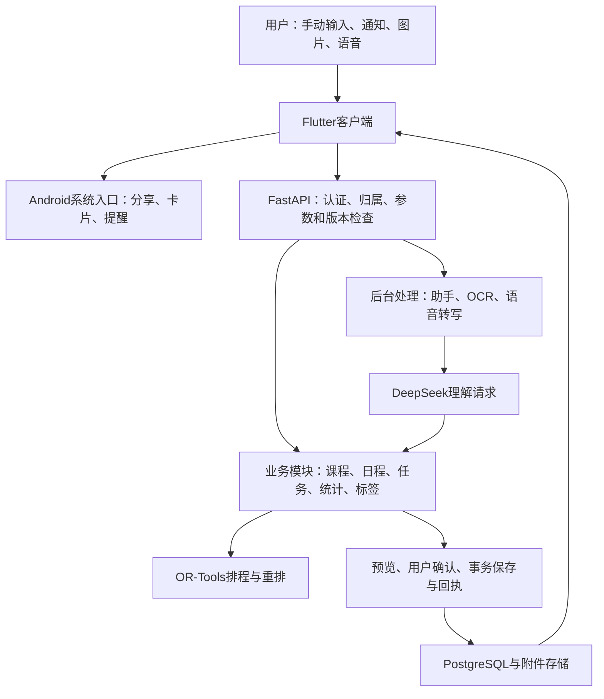

# 拾日软件设计资料

版本：1.1.1（Android构建12）。更新：2026-10-17。本文根据当前源码整理，完整功能入口见[功能清单](../功能清单.md)。

## 一、产品目标与使用过程

大学生的安排分散在教务课表、群通知和待办中。课程按周重复，临时活动经常只有开始时间，任务又可能只有一个截止日期。拾日把这些内容放在同一个学期下，帮助用户记录、查询、检查冲突和安排学习时间。

典型过程是建立学期、导入课表、记下通知或待办、检查冲突并保存；需要学习方案时，再补充预计用时和可学习时段。临时变化后可以固定重要计划，只调整受影响的部分。普通手动操作与助手共用同一份记录。

## 二、完整功能设计

| 模块 | 提供的内容 |
| --- | --- |
| 账号与资料 | 注册、登录、恢复码、重置密码、退出，个人与学习偏好、首次引导和使用说明 |
| 学期与课程 | 创建及切换学期、完整节次编辑、河南工大及黑大导入、手动录入、课程详情、课次调整和请假 |
| 今日 | 当前及后续安排、待办、考试信息、空档建议、本周忙闲、内容与排序设置 |
| 日程 | 周课表、列表、切周及日期定位、日程新增和修改、未知时间展示、详情与历史 |
| 任务与考试 | 任务、作业、考试记录，状态、排序、批量操作、关联课程、提醒与进度 |
| 通知助手 | 文字、图片、语音、系统分享和剪贴板入口，查询、多轮更正、预览编辑、确认、回执、核实与撤销 |
| 学习安排 | 每周多段时段、批量设置、临时排除、休息及缓冲，预计用时、开始条件、方案、固定及重排 |
| 标签 | 本地规则推荐与分组、同类名称自动合并、手动管理、跨学期关联列表与详情 |
| 搜索与统计 | 课程、日程、事项、来源文字检索，日期、分类、标签、时长与实际进度统计 |
| Android入口 | 本地提醒、离线延后、静默、权限与测试通知、桌面卡片、快速记录和进行中通知 |
| 数据维护 | 来源核对、重试及删除附件，历史对话、学期删除、JSON导出、反馈与注销 |

## 三、系统架构

客户端展示数据、接收输入和处理本机系统接口。服务端负责真实记录、冲突、权限与事务。后台进程处理较慢的识别和助手任务。模型理解自然语言、选择查询和业务工具；求解器处理学习时间，标签使用独立程序规则。

## 四、客户端模块

主界面为今日、日程、任务、学期，页面状态和滚动位置按账号、学期区分。助手以面板或独立页面打开，能携带正在浏览的范围。账户页连接资料、说明、提醒、桌面卡片、反馈及数据管理。

表单分必要和补充信息；未给日期、结束或用时的记录可以先保存。日程冲突、课次调整、重排和撤销使用相应预览，用户确认后才调用正式写入。保存处理中不提前显示成功，网络不明时先核实上次结果。

主题、按钮、输入框、列表、弹层和时间选择器集中复用。保留文字缩放、读屏标签、高对比、减少动画和键盘避让。太阳月亮、波浪、导航、完成反馈跟随实际页面和操作状态；隐藏页面停止装饰动画。

## 五、服务端与数据

| 记录 | 内容与关系 |
| --- | --- |
| 用户和会话 | 密码哈希、恢复状态、会话与刷新校验；所有业务记录归属用户 |
| 学期 | 第一周周一、总周数、节次和修订号 |
| 课程与课次变更 | 课程周次、星期、节次；具体日期的停课、调整、请假与恢复 |
| 日程 | 活动标题、时间含义、确定性、地点、本人参加情况、来源和提醒 |
| 事项 | 任务、作业、考试、期限、预计剩余、开始条件、优先级与生命周期 |
| 学习时段与方案 | 每周允许时段、排除、休息缓冲；候选方案与正式时间块、固定状态 |
| 进度与历史 | 实际学习记录、资源版本、修改前后和撤销依据 |
| 标签与别名 | 账号共用的标签、合并指向、旧名称和关联资源ID |
| 来源与处理任务 | 文件、原始文字、识别结果、状态、重试与删除标记 |
| 对话与预览 | 消息、处理进度、待确认操作、保存结果和删除状态 |
| 资料与反馈 | 用户资料、学习偏好、反馈描述及版本 |

主要表定义在 `services/api/app/models.py`，迁移位于 `alembic`。正式环境使用PostgreSQL，单元测试通常使用临时SQLite，数据库专项在独立PostgreSQL执行。

## 六、时间和冲突

时间同时记录精度和用途。精度可以为具体时刻、日期、周次、日期范围和未知；用途区分开始、截止、办理窗口、候选和全天。上海时区用于日期、周次与界面，具体时刻按带时区数据保存。

“明天9点开会”只记录开始，没有结束。“周五交报告”保留日期，不自动变成23:59。“8:10候场、9点开始”分开记录到场和正式开始。普通“第几节课”按学生常说的大节，结合本学期节次表核对。

保存固定安排时，比较修改前后，确定新增冲突。9:15开始落在9:00—9:50课程内，需要处理该课次；未知散会时间不代表下午全部冲突。本人不参加的参考活动可以保留记录，不计占用。

记录活动并同时标记某次课已请假时，二者在同一事务保存。请假只记录用户已完成的校外流程，不向学校申请；待请假仍算课程占用，已请假课次从普通日程隐藏。

## 七、主要流程

### 1. 导入课程

选择学校 → 在教务网页登录并查询学期 → 读取课表 → 核对课程、周次、节次、地点及附加事项 → 确认后保存。

读取脚本只提取允许字段，页面跳转或超时后旧结果失效。河南工大10节作息随预览保存，确认时与课程一并应用；取消或失败不留下部分作息修改。其他学校走适配器或手工录入。

### 2. 整理通知与保存

多事项通知按组呈现，用户可以选择保存部分。后续更正先核对原记录；原通知与补充消息分开保留。模型不能用一句回答直接写数据库，文字“确认”也不代替界面动作。

### 3. 任务排程与重排

系统把课程展开成日期上的课次，结合固定活动、本人出勤、学习时段、休息、缓冲和排除得到可用时间。任务提供剩余用时、期限及开始条件；允许拆分时按对应策略形成时间段。求解结果经检查并展示，确认后保存。

新增固定活动后，保留原课程、考试、固定计划和未选任务，重排选定的个人学习安排。优先减少移动数量，再减少移动距离，再考虑更早安排。用时与身份保持；超时或局部可行结果按实际状态显示。

### 4. 标签整理和查看

程序根据标题与课程等信息推荐标签。旧的组会、座谈会、班会和例会归到会议，彩排与联排归到排练，其他同用途名称按词表统一。进入标签页会自动整理，保留旧ID及旧名称解析，不改标题、原文和时间。

点名称查询该账号全部学期的关联事项和日程，包含完成及取消状态；列表分页，失败可重试，详情使用正确学期会话。普通手动管理仍能预览重命名或合并影响。

### 5. 系统提醒和桌面

后端保存提醒规则，客户端同步后使用系统闹钟和通知。无精确权限时降为非精确调度。离线延后核对本机已知记录；正式完成仍请求服务器。重启、权限和数据变化会触发相应核对。

卡片使用本机同步数据。进行中通知由用户开启，倒计时或已开始时长交给系统显示，支持停止与到时撤下。Android16申请增强展示，具体胶囊样式由系统决定。应用没有靠无任务前台服务常驻。

### 6. 数据和反馈

来源详情可看原图、录音与识别文字、修正和重试、删除附件。对话删除停止未完成处理，保留已保存事项。学期删除先核对关联数量。JSON导出通过系统文件入口保存，采用字段白名单；注销需密码和明确文字，附件由清理队列处理。反馈由用户提交、维护者通过只读工具查看。

## 八、一致性与异常处理

记录版本和学期修订共同防止旧预览覆盖新数据。写入使用幂等请求和保存回执，重复确认不重复新增。网络返回不明时先查上次结果，保存成功但同步失败时重试同步。

撤销按现状计算恢复结果，会引入新冲突时拒绝恢复。来源、课程和学期都检查归属；账号切换使旧请求失效，缓存和系统入口按账号清理。跨学期标签详情不改变主界面所选学期。

上传先处理文件，再用线程内独立数据库会话完成短事务。登录在验证后锁定并重读密码状态；刷新提供短时幂等重试。退出的各项清理分别处理，凭证持久化删除失败不会显示为完整退出。

## 九、部署、验证和维护

服务端提供API、worker、PostgreSQL、附件卷和只读识别模型目录，通过HTTPS反向代理访问。Alembic迁移、发布目录、备份与回滚脚本用于维护。Android包使用原证书覆盖升级，版本、地址、架构和对齐在构建时核验。

1.1.1的测试、线上验证和APK信息见[交付说明](../交付说明.md)。历史算法实验、模拟器场景和当前回归分别注明日期。测试数据与用户反馈意见不混算，未测结果明确保留。

## 十、范围与后续工作

当前交付Android及后端，学校适配有两所。学习耗时由用户估计，实际进度需维护；尚无个人耗时学习、自动每日复盘、团队协同和反馈工单回复。系统提醒和增强样式受设备权限与厂商影响，更多真机和真实学校需要继续验证。

所有页面操作见[使用说明](../产品规则.md)，所有HTTP路由和请求实现见[接口索引](../接口索引.md)，算法与历史实验见[核心算法说明](拾日核心算法说明.md)。
